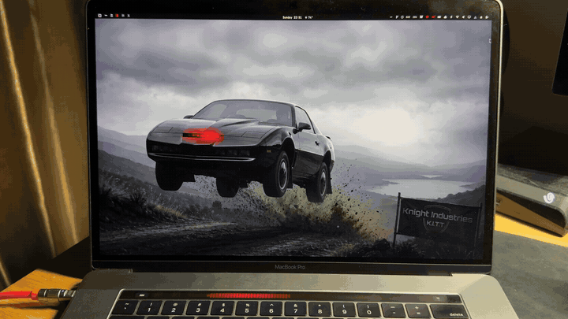
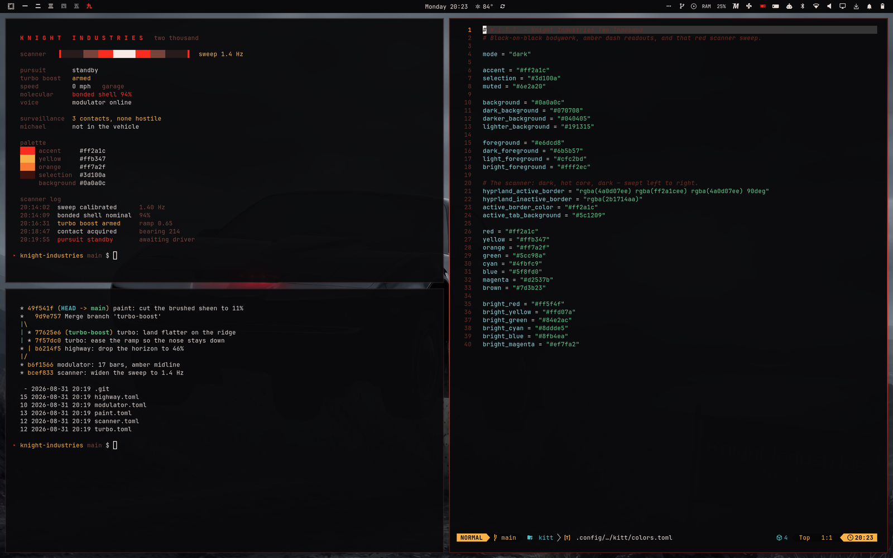

# K.I.T.T.



An [Omarchy](https://omarchy.org) theme based on the Knight Industries Two
Thousand from *Knight Rider* — black-on-black bodywork, amber dash readouts,
and that red scanner sweep.



*Screenshot contents are mock data — the telemetry readout and the
`knight-industries` repository are staged for the shot.*

## Install

```bash
omarchy theme install https://github.com/moerdowo/omarchy-kitt-theme.git
```

Or manually:

```bash
git clone https://github.com/moerdowo/omarchy-kitt-theme.git ~/.config/omarchy/themes/kitt
omarchy theme set kitt
```

## Palette

| Token | Colour | |
|---|---|---|
| `background` | `#0a0a0c` | the paintwork |
| `foreground` | `#e6dcd8` | |
| `accent` / `red` | `#ff2a1c` | the scanner |
| `yellow` | `#ffb347` | dash amber |
| `orange` | `#ff7a2f` | |
| `selection` | `#3d100a` | |

Window borders use a three-stop Hyprland gradient —
`rgba(4a0d07ee) → rgba(ff2a1cee) → rgba(4a0d07ee)` at 90° — so the focused
window reads as a red sweep from left to right. Inactive borders drop to a
dead `rgba(2b1714aa)`.

Everything else (terminals, btop, neovim via aether, vscode, chromium,
obsidian, the bar and all shell surfaces) is generated from `colors.toml` by
Omarchy's own templates.

## Backgrounds

Cycle with `omarchy theme bg next`.

| | |
|---|---|
| `1-kitt-jump` | the car mid-jump on a storm-lit ridge, scanner lit — the default |
| `2-scanner` | the red sweep across black, white-hot core, CRT scanlines |
| `3-voice-modulator` | the dash LED bar cluster in red with an amber midline |
| `4-night-highway` | 80s perspective grid receding to a red horizon glow |
| `5-black-on-black` | brushed near-black paint, one thin scanner line low in frame |

Backgrounds are applied in filename order, so `1-kitt-jump` is what the theme
sets when you switch to it.

2–5 are generated procedurally with ImageMagick at 2880×1800; `regenerate.sh`
rebuilds them. Budget around nine minutes — it is compositing a few dozen
full-size layers and is not hung. Backgrounds 2–4 reproduce exactly;
`5-black-on-black` draws its brushed sheen from `+noise Gaussian`, so its
texture differs slightly on every run.

`1-kitt-jump` is composed from a source photo and is not regenerated by the
script.
